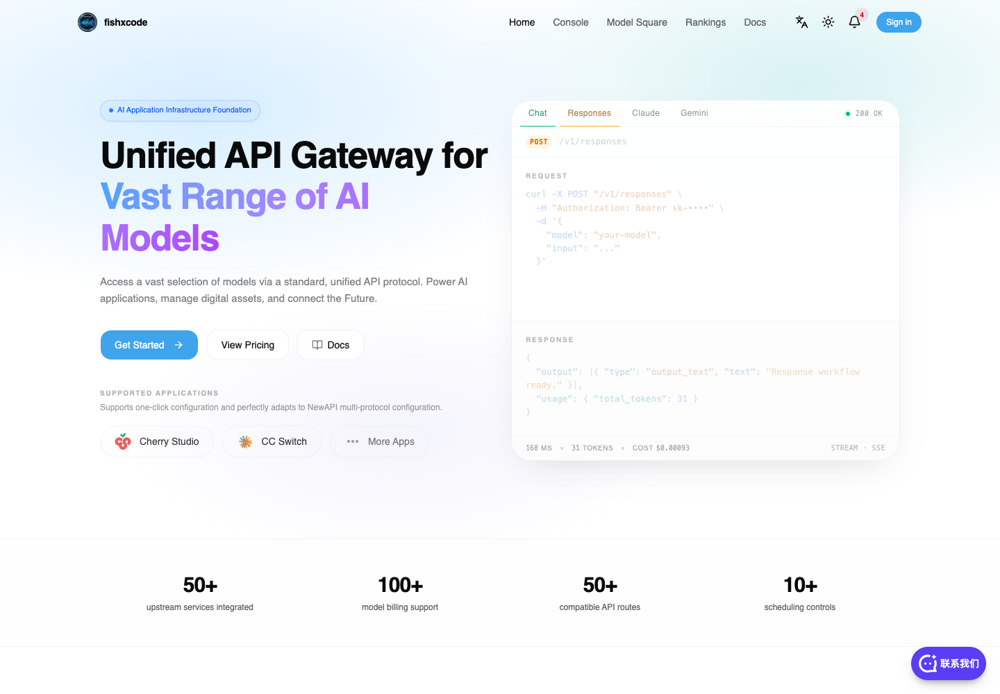
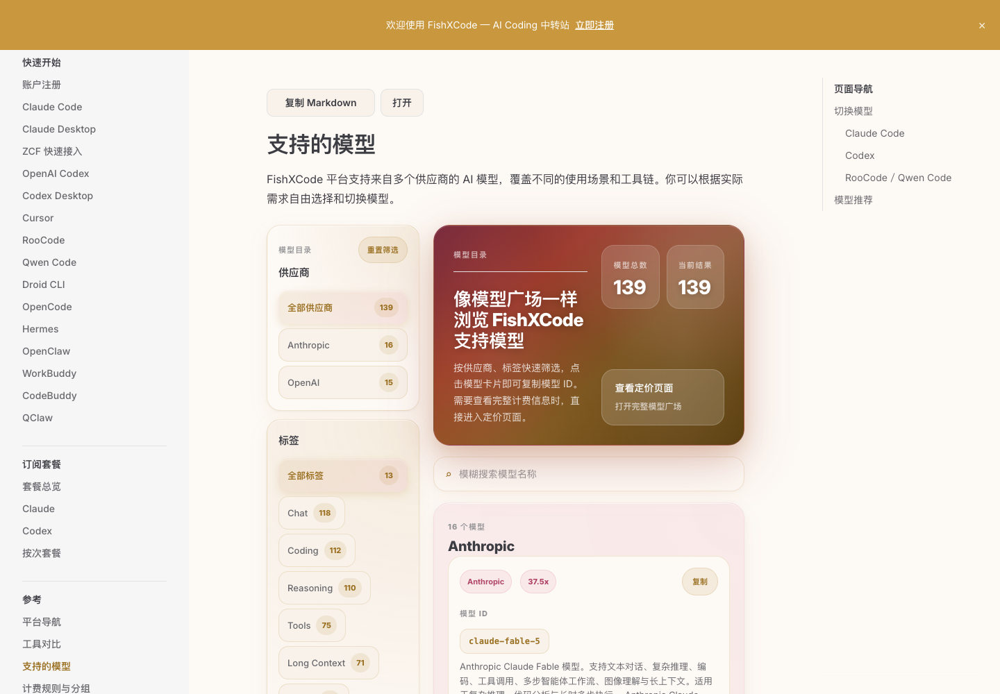
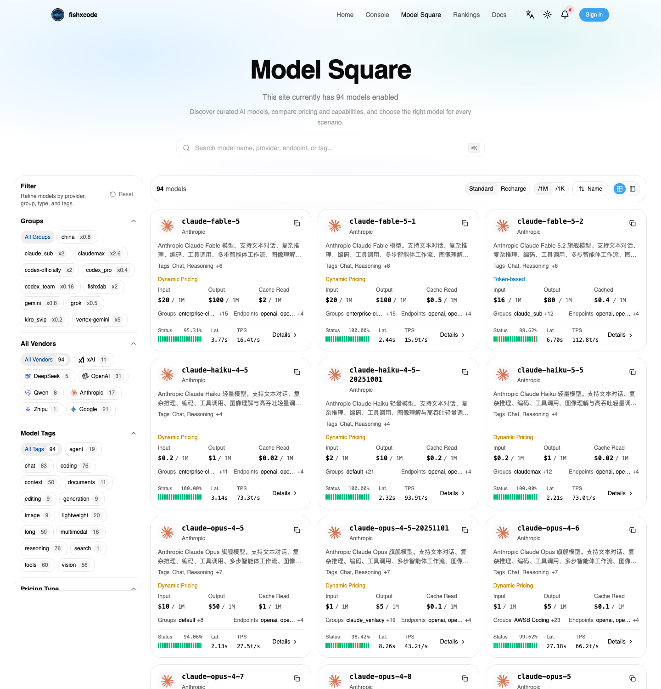
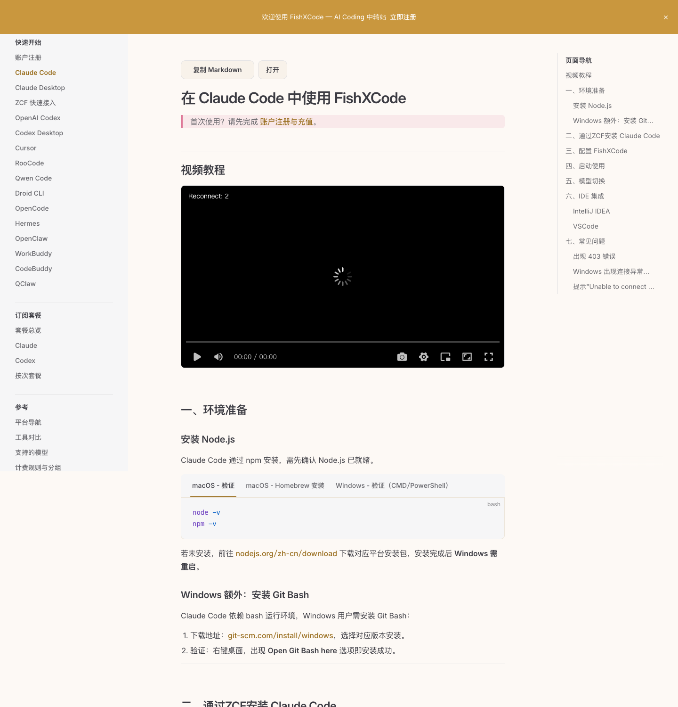

# FishXCode套餐攻略：Codex额度、按次套餐与余额按量怎么选

**购买结论：FishXCode围绕AI Coding设计，购买方式分为余额按量、Codex额度和按次套餐。它更像Coding套餐商店，而不是把所有模型塞进同一倍率的普通聚合网关。**

[打开FishXCode注册与价格页](https://fishxcode.com/sign-up?aff=HOvo)

## FishXCode能替代什么

临时项目或模型经常变化时选余额按量；Codex任务持续且可预测时比较额度与有效期；每天请求数较稳定时再看按次商品。三种入口的成本逻辑不同，不能只比较标价。

## 价格与套餐重点

按量余额会结合输入、输出、缓存和Key分组扣费。Codex套餐还要看包日、包周或包月有效期；按次系列则受日/月/总次数和频控影响，部分列示型号会按2.5倍成功请求数累计。

## 充值步骤与支付方式

充值前先登录账户选择商品类型。余额可通过支付宝、微信或兑换码入口增加；购买套餐时同时查看有效期、允许模型、周期上限与团队共享额度，避免剩余额度到期失效。

[进入FishXCode完成注册](https://fishxcode.com/sign-up?aff=HOvo)

## Claude Code / Codex接入

Claude Code填写`https://api.fishxcode.com/`并使用专用Key；Codex provider填写`https://api.fishxcode.com/v1`。两个客户端分开建Key，能直接比较各自的调用消耗。

## 怎样买得更划算

FishXCode适合Claude Code与Codex占主要工作时间的人。只偶尔调用一个模型时，普通按量平台会更简单；Coding任务长期稳定后，FishXCode多种套餐才更容易发挥优势。

### FishXCode选购动作

1. 打开94个已启用模型的价格页，先确认常用Claude或Codex型号仍在售；
2. 用量零散时选择余额按量，核输入、输出、缓存和Key分组；
3. 每天持续跑Codex时，再比较包日、包周、包月额度及有效期；
4. 请求大小接近且数量稳定，才研究按次系列的日上限、月上限与总次数；
5. Claude Code与Codex分别建Key，避免两种商品和两套日志互相干扰。

## FishXCode具体价格与规则

公开价格页列出`claude-haiku-4-5`输入$0.18、输出$0.90，`claude-sonnet-4-6`输入$0.54、输出$2.70，单位为每百万token。`codex-auto-review`输入$1.50、输出$9.00。按次文档还列明部分Claude Opus 4.8与GPT-5.5请求按2.5倍成功次数累计，并受每分钟10次等周期限制。

## FishXCode接入问答

### Claude Code使用哪个公开地址？

环境变量中的`ANTHROPIC_BASE_URL`填写`https://api.fishxcode.com/`，认证令牌使用控制台生成的Claude专用Key。

### Codex的Base URL相同吗？

Codex provider使用`https://api.fishxcode.com/v1`，认证文件另存API Key。不要把Claude Code地址原样复制进Codex配置。

### 什么时候额度包比按量合算？

最近一周的Codex消耗稳定、有效期内能用完额度，并且日上限不会卡住高峰时，额度商品才可能比余额按量更合适。

### 按次商品最容易忽略什么？

除总次数外，还要计算2.5倍型号占比、每分钟频控、每日上限和到期剩余次数，否则标称次数并不等于真实可完成任务数。

## FishXCode结论

FishXCode面向AI Coding用户提供三条明确购买路线：偶发任务走余额、持续Codex工作看额度、稳定短请求比较按次。94个在售型号、两套公开Base URL和细分套餐规则，适合愿意按真实用量选商品的开发者。

[查看FishXCode当前Coding商品](https://fishxcode.com/sign-up?aff=HOvo)

FishXCode流量词

FishXCode价格 · FishXCode套餐 · FishXCode充值 · FishXCode Claude Code · FishXCode Codex

*核对日期2026-11-18，模型数量与套餐限制以FishXCode实时页面为准。*

## fish替代与相关搜索

本文覆盖fish价格、fish充值、fish接入，以及它与官方API和单线中转的替代关系。
